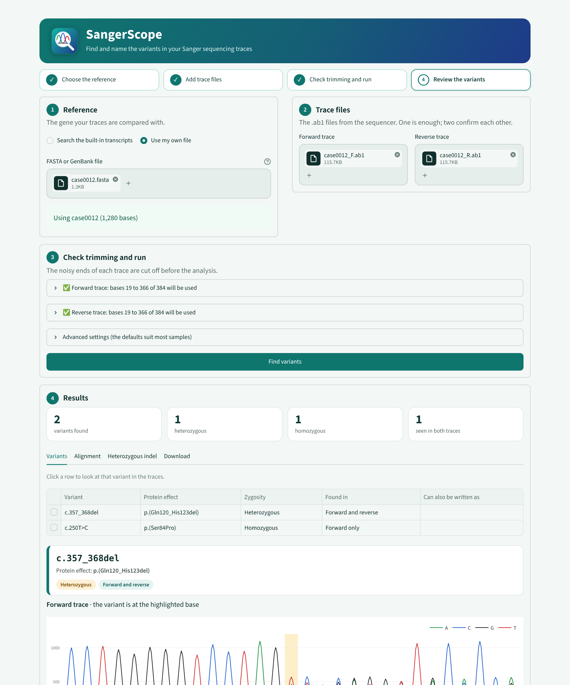

SangerScope Ver 3.2.0
======================
SangerScope is a free software for Sanger sequencing analysis in clinical environment.<br>
It supports automatic detection of variants including SNVs and indel variants (homozygous and heterozygous).<br>
Detected variants are provided in the form of HGVS (Human Genome Variation Society) nomenclature.

It runs in the browser and from the command line.



# 1. How to Run
**Windows, with the setup program:** download `SangerScope-3.2.0-Setup.exe` from the [latest release](https://github.com/alrafaykhan/SangerScope/releases/latest) and run it. Nothing else needs to be installed. Start SangerScope from the desktop shortcut; it opens in your browser. Keep the black window open while you work, and close it to stop.<br>
The setup program is not code-signed yet, so Windows SmartScreen shows a blue "Windows protected your PC" window: choose "More info", then "Run anyway".

**Windows, without the blue warning:** open Windows PowerShell (Start menu, type "PowerShell"), paste this line and press Enter:

```
irm https://raw.githubusercontent.com/alrafaykhan/SangerScope/master/packaging/windows/install.ps1 | iex
```

It downloads the same program from the latest release, installs it for your user account and creates the same shortcuts. No administrator rights are needed. To remove it, delete the folder `%LOCALAPPDATA%\Programs\SangerScope` and the shortcuts.

**Any system, from the source code:** you need [Python](https://www.python.org) 3.11 or higher.

```bash
git clone https://github.com/alrafaykhan/SangerScope.git
cd SangerScope
pip install -e .
sangerscope app
```

`sangerscope app` starts the browser interface on your own computer (http://localhost:8501). Trace files are not sent anywhere else.<br>
On start, SangerScope asks GitHub once whether a newer version exists and shows a notice if so; set `SANGERSCOPE_NO_UPDATE_CHECK=1` to switch this off.<br>
The bundled reference transcripts are read from the `reference` folder of the repository; set `SANGERSCOPE_REFERENCE_DIR` to use another folder.

# 2. How to Use
1. Choose a reference sequence:<br>
&nbsp;&nbsp;- **Human genes (built in):** search the bundled RefSeq transcripts by gene name or accession.<br>
&nbsp;&nbsp;- **Any organism (NCBI):** bacteria, viruses or any other organism. Search by organism and gene name (for example "Mycobacterium tuberculosis" and "rpoB"), or give the accession of a genome, plasmid or gene record (for example NC_045512.2) and pick a gene from its list. The gene is downloaded from NCBI with 500 bases on each side, turned to read forwards if it lies on the reverse strand, and numbered from its start codon. The protein effect uses the genetic code of the organism. Only the search words or the accession are sent to NCBI; trace files stay on your computer.<br>
&nbsp;&nbsp;- **My saved references:** every gene downloaded from NCBI is kept on your computer (in the `.sangerscope/references` folder of your user folder) and works without internet afterwards.<br>
&nbsp;&nbsp;- **My own file:** a FASTA (coding regions in upper case, everything else in lower case) or GenBank file.<br>
2. Add a forward and/or reverse trace file (.ab1).<br>
3. Check the trimming of the low-quality ends.<br>
Proper trimming is important for the correct identification of a heterozygous indel variant.<br>
Since bases with double peaks have low phred scores, the initial suggestion is to trim out the superimposed area generated by a heterozygous indel variant.<br>
In cases with heterozygous indel variants, adjust the "Bases to use" slider in order to include the maximal number of valid bases (including double peaks) and the minimal number of noise signals.<br>
4. Click 'Find variants'.<br>
5. The variant table is shown. Select a row to see the variant in the traces. The "Peak height" slider makes the peaks taller, so that weak signals and small second peaks are easier to see; it changes the picture only. The "Alignment" tab shows the aligned sequences, and the "Heterozygous indel" tab shows the two alleles separated from the double peaks.<br>
6. For every variant SangerScope gives:<br>
&nbsp;&nbsp;- the name in HGVS nomenclature and the **protein effect**, for example `p.(Ser450Leu)`, `p.(Phe924=)` for a silent change, `p.(Met1?)` for a changed start codon, `p.(Arg97Profs*23)` for a frameshift;<br>
&nbsp;&nbsp;- the **effect type**: missense, synonymous, nonsense, frameshift, in-frame deletion/insertion, start lost, stop lost, splice site (first two intron bases), splice region, intronic, 5' UTR or 3' UTR;<br>
&nbsp;&nbsp;- for heterozygous SNVs, a rough estimate of the **proportion of the signal** that carries the variant, from the peak heights;<br>
&nbsp;&nbsp;- for genes downloaded from NCBI, the **position on the genome** record; for human transcripts, links that search the variant in **ClinVar** and **VarSome**.<br>
7. Every variant has a **signal quality** rating: Good (clean signal), Check (look at the trace before reporting) or Poor (do not report without repeating the sequencing or confirming on the other strand). The rating uses the base quality values at and around the variant, double peaks in the surrounding bases, the size of the second peak for heterozygous calls, and whether the other trace shows the variant. Variants rated Poor are shown and marked in red; a switch above the table hides them. A warning is shown when a whole trace is of poor quality. The rating is a guide, not a validated cut-off, and it does not change which variants are called.<br>
8. Not every double peak is a heterozygote. For every heterozygous SNV, SangerScope checks the **peak shape** of the double peak and shows it in its own column (✅ typical, ⚠️ check, ❌ not typical). A real heterozygote shows two peaks centred on the same position, a second peak of normal width and roughly symmetric (not a broad dye blob or a one-sample spike), a second peak well above the background of its colour, a second colour that is not simply bleed-through (the same small signal under the other peaks of the main colour), and a main peak reduced to about half of nearby single peaks. A double peak that fails these checks is rated "not typical" and its signal quality is set to Poor, with the reason shown. The variant stays in the list, so that a real but unusual heterozygote is not lost; the decision remains with the reviewer, ideally with confirmation on the other strand.<br>
9. The "Download" tab gives a printable report (PDF) with your sample ID and name, and the variant table (TSV, JSON).

**Many samples (batch):** choose "Many samples (batch)" at the top, pick one reference and add the trace files of all samples at once. Forward and reverse files are paired by their names (`sample_F.ab1` / `sample_R.ab1`, also `Fwd` / `Rev`, `Forward` / `Reverse`; a plate well after the direction is ignored). Check the pairing table, run, and download one table with all variants and a zip with one PDF report per sample. In batch mode the suggested trimming is applied without review, so heterozygous indels whose double peaks are trimmed away are not detected; samples marked "trimming needs review" should be opened as one sample.

For human genes, ★ marks the **MANE Select** transcript, the one recommended for clinical reporting (MANE v1.5). The built-in transcripts date from 2021; where the current MANE Select version is newer, the current version number is shown.

# 3. Command Line
One sample:

```bash
sangerscope run --ref BRCA2 --fwd sample_F.ab1 --rev sample_R.ab1 --report sample.pdf
```

`--ref` takes a FASTA/GenBank file, a built-in transcript name such as `NM_000059.3(BRCA2)`, or a gene symbol (its MANE Select transcript is used). A reference for another organism is downloaded once with `sangerscope fetch` and then used by name:

```bash
sangerscope fetch --organism "Mycobacterium tuberculosis" --gene rpoB
sangerscope run --ref "NC_000962.3(rpoB)" --fwd sample_F.ab1 --rev sample_R.ab1
```

`sangerscope fetch --accession NC_045512.2` lists the genes of a record; add `--gene S` to download one. The variant table is written to standard output (`--format tsv|csv|json`, `--out FILE`).

Many samples, listed in a CSV or TSV manifest with the columns `sample`, `reference`, `forward`, `reverse`:

```bash
sangerscope batch manifest.csv --out results.tsv --report-dir reports
```

The same batch analysis is available in the browser interface.

# 4. Parameter optimization
Generally SangerScope works fine with default parameters.<br>
However, parameters described below could be adjusted for the refinement of results.<br>
1. Cutoff for double peak detection (Advanced settings)<br>
To detect somatic variants, lower value than default value, such as 0.1~0.2 may be required.<br>
This adjustment could result in increased number of false positive variant calls. <br>
2. Gap opening penalty (Advanced settings)<br>
Manual adjustment of gap opening penalty is not necessary.<br>
When a higher value of gap opening penalty is required, SangerScope automatically applies a higher gap opening penalty and notifies the user that the heterozygous indel optimization mode is activated. <br>
3. Number of consecutive matches for finishing the search for the end of delins variant<br>
In normal cases, use of default value 5 is recommended. (range 1-10)<br>
In High quality traces, using higher values will give correct delins variant calling. <br>
In Poor Quality traces, increasing this value will result in the tendency of calling delins variants with longer insertion sequences. Decreasing this value will result in the tendency of calling delins variants with shorter insertion sequence or ins/del variant instead of delins variant. <br> 

# 5. Validation
The analysis was checked against the reference implementation of the method (see Acknowledgement): both were run on the same input and gave the same alignment and the same variant calls, on 2,500 simulated cases (SNVs, insertions, deletions, duplications and delins variants, homozygous and heterozygous, on one or both strands) and on four public real traces.

Simulated traces are cleaner than real ones. Before clinical use, validate SangerScope on your own traces with known variants, as for any analysis software.

Run the tests with `pip install -e ".[test]"` and `pytest`.

# 6. Utilized Libraries
NumPy, Biopython (GenBank files), Streamlit and Plotly (browser interface), fpdf2 (PDF report)<br>

# 7. License and Acknowledgement
SangerScope is distributed under the Apache License, Version 2.0 (see LICENSE and NOTICE).<br>
The analysis method and the bundled reference sequences are derived from SnackVar by Young-gon Kim. If you use SangerScope in published work, please cite:<br>
Kim YG, Kim MJ, Lee JS, Lee JA, Song JY, Cho SI, Park SS, Seong MW. SnackVar: An Open-Source Software for Sanger Sequencing Analysis Optimized for Clinical Use. J. Mol. Diagn. 2021;23:140-8. <br>

# 8. Updates
**Ver. 3.2.0**<br>
Peak shape check for heterozygous calls: co-location of the two peaks, peak of its own, width and symmetry, height above background, colour bleed-through, and reduction of the main peak <br><br>
**Ver. 3.1.3**<br>
Peak height slider placed directly above the trace pictures, and also available in the trimming view <br><br>
**Ver. 3.1.2**<br>
Installation on Windows by one PowerShell line, which avoids the SmartScreen warning of the unsigned setup program <br><br>
**Ver. 3.1.1**<br>
Faster browser interface: the report is built only when downloaded, references are read once, and only the part of the trace around a variant is drawn <br>
"Peak height" control for the trace pictures <br>
Link that searches the variant in VarSome <br>
Variants with poor signal quality shown by default (a switch hides them) <br><br>
**Ver. 3.1.0**<br>
Protein effect written to HGVS recommendations (silent, start codon, stop codon and frameshift changes) <br>
Effect type for every variant, including splice site and splice region <br>
Proportion of the signal carrying a heterozygous variant <br>
Variants with poor signal quality can be hidden <br>
Batch mode in the browser interface, with pairing of forward and reverse files by name <br>
PDF report with sample ID and analyst <br>
MANE Select transcript marked and used when a gene symbol is given <br>
Genome position for genes downloaded from NCBI; ClinVar search link for human transcripts <br>
Notice when a newer version is available <br>
Windows installer: reference sequences packed into one archive (faster installation) <br><br>
**Ver. 3.0.0**<br>
Browser interface, command line tool and batch mode <br>
References for any organism from NCBI, by organism and gene name or by accession <br>
Signal quality rating for every variant and a warning for poor traces <br>
Variant table export (TSV, CSV, JSON) and HTML report <br>
Amino acid change corrected for SNVs in codons interrupted by an intron <br>
Amino acid change no longer reported for SNVs in the 3' UTR <br>
